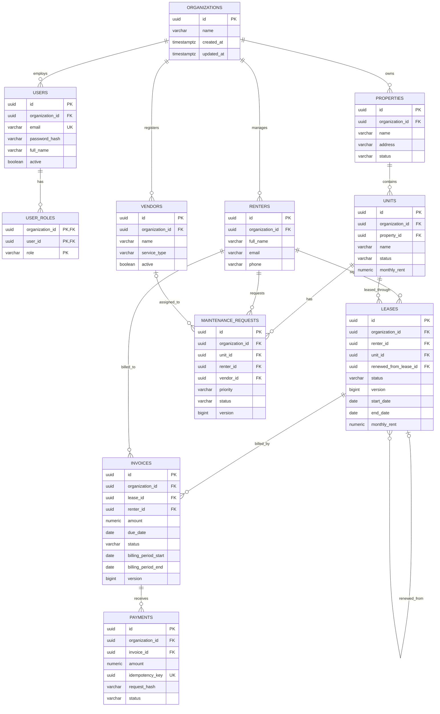

# Entity relationship diagram

`organization_id` is included on each organization-owned record. Relationships between
organization-owned tables use composite foreign keys `(organization_id, id)` so that a
record in one organization cannot reference a record owned by another organization.
